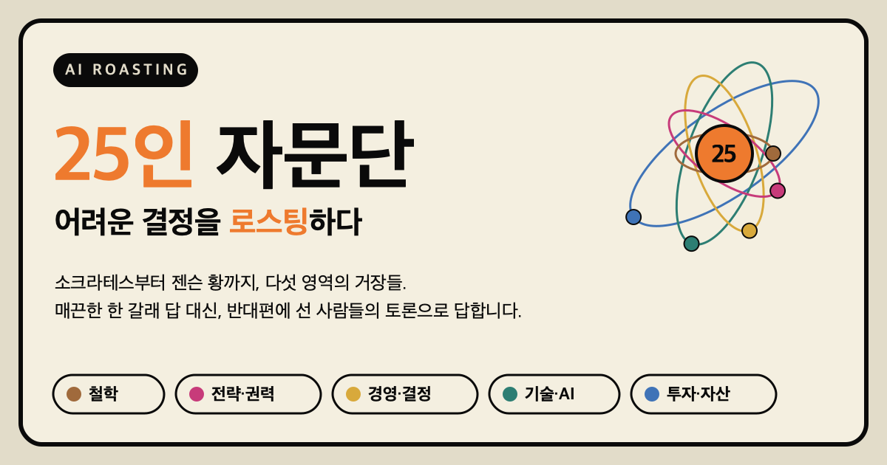

# AI ROASTING 자문단

<p align="center">
  <a href="https://council.airoasting.com/"></a>
</p>

<p align="center">
  
  
  
  <a href="scripts/validate_agents.py"></a>
</p>

> 고개만 끄덕이는 회의는 잊으세요. 25인의 거장이 당신의 결정을 로스팅합니다.
>
> 까려는 게 아닙니다. 밀어붙이기 전에 가장 강한 반대를 미리 듣는 자리입니다.

Claude Code에서 `/council` 한 줄로 씁니다(플러그인으로 설치했으면 `/council:council`). 25명의 전문가 가운데 질문에 맞는 사람들을 서로 반대편에 앉혀 토론시키고, 매끈한 합의 대신 표결, 엇갈린 지점, 판단 규칙, 이번 주 첫 행동을 돌려줍니다. 시장 진입, 조직 개편, 인수, 핵심 인재를 붙잡을지 보낼지처럼 혼자 떠안은 결정 앞에서 씁니다.

[시작하기](#시작하기) · [첫 질문 쓰는 법](#첫-질문은-이렇게) · [사이트](https://council.airoasting.com/)

## 이렇게 나옵니다

1.2.0으로 실제로 돌린 토론(2026-10-31, 전체 모드, 약 6분)의 종합 의견입니다. 라운드 기록만 빼고 그대로 옮겼습니다.

> **문제** 직원 60명 B2B 회계 소프트웨어 회사입니다. 개발자 25명 중 15명을 AI 에이전트 신제품으로 옮길까요? 흑자이고 기존 고객 이탈은 없으며, 가장 빡빡한 것은 사람입니다.<br>
> **소집** 클레이튼 크리스텐슨, 짐 콜린스, 일론 머스크, 나심 탈레브, 피터 드러커 · 전체 모드<br>
> **가를 선택지** 15명 이동 / 5~7명 팀 / 기존 제품 안 기능 / 지금은 하지 않음 (질문의 "15명 이동" 말고는 자문단이 짜서 시작 전에 확인받은 안)
>
> ### AI ROASTING 종합 의견
>
> **한눈에**
> - 권고: 15명 대신 5~7명 팀으로 시작합니다 (5명 중 3명)
> - 뒤집힐 조건: AI 때문에 서명을 미룬 계약이 한 건도 없으면 지금은 하지 않음으로 갑니다
> - 이번 주 할 일: 최근 석 달 영업 기록에서 AI 때문에 서명을 미룬 건을 셉니다
>
> **직답 표결** (15명 이동 / 5~7명 팀 / 기존 제품 안 기능 / 지금은 하지 않음): 5~7명 팀 3명, 기존 제품 안 기능 2명, 15명 이동 0명, 지금은 하지 않음 0명 (합의 정도일 뿐, 결정을 대신하지 않습니다)
> - 클레이튼 크리스텐슨: 5~7명 팀. 기존 제품 안에 넣으면 기존 고객 기준에 밀려 새 고객 쪽을 못 봅니다 (확신도 중간)
> - 일론 머스크: 5~7명 팀. 15명은 되돌릴 수 없고, 5~7명은 시제품으로 확인할 수 있는 크기입니다 (확신도 낮음)
> - 나심 탈레브: 5~7명 팀. 따로 선 작은 팀은 실패해도 그 팀만 잃습니다 (확신도 중간)
> - 짐 콜린스: 기존 제품 안 기능. 돈 버는 회계 제품을 같은 사람들이 한 번 더 미는 쪽이 낫습니다 (확신도 중간)
> - 피터 드러커: 기존 제품 안 기능. 고객은 이미 이 제품에 일을 맡기고 있고, 거기서 확인하는 게 가장 싸고 빠릅니다 (확신도 낮음)
>
> **아직 안 풀린 질문**
> - 외부 에이전트 연결(직접 만들지 않고 외부 업체 에이전트를 붙이는 안, 개발자 1~2명)은 2명이 빠졌다고 봤지만 이번 토론에서는 다루지 않았습니다.
> - 회계 담당자가 없는 소규모 사업자처럼 아직 고객이 아닌 사람들의 수요는 기존 고객에게 전화해서는 알 수 없습니다.
> - 15명을 빼면 남는 10명이 세법 변경을 감당할 수 있는지 모릅니다. 머스크는 기존 제품에 18명 이상을 남기자고 했습니다.
>
> **서로 엇갈린 지점**
> - 탈레브: 에이전트를 기존 제품에 붙였다가 사고가 나면 기존 고객 전체의 장부와 신뢰로 번집니다. 따로 세우는 쪽이 더 안전합니다.
> - 콜린스: 신제품은 기존 고객이라는 기반 없이 시작합니다. 5~7명에게 두 방향을 다 시험시키면 어느 쪽도 끝까지 못 갑니다.
> - 드러커: 고객의 답을 듣기 전에 팀 크기부터 정하면 순서가 거꾸로입니다. AI 때문에 막힌 계약이 열 건 중 서너 건은 되어야 팀을 세웁니다.
>
> **전문가들이 동의한 지점**
> - 지금 근거로 15명을 옮기자는 전문가는 없었습니다.
> - 근거는 고객의 말이 아니라 돈이 걸린 행동이어야 합니다. 서명을 미룬 계약, 계약서에 AI 항목을 넣어 달라는 요구 같은 것입니다.
> - 어떤 시험이든 사람이 승인하기 전에는 에이전트가 장부에 쓰지 못하게 합니다.
>
> **멈춰야 할 신호**
> - 팀을 세우기 전에 중단 기준(검수 정확도 같은 측정값과 중단 날짜)을 종이에 적지 못하면 → **지금은 하지 않음**. 기준 없는 팀은 "곧 됩니다"라는 말만 남긴 채 계속 굴러갑니다.
> - 석 달 안에 팀의 과제 목록이 기존 고객 요청으로 채워지면 → **기존 제품 안 기능**. 이름만 신제품이고 실제로는 기능 팀이 된 것입니다.
>
> **판단 규칙** (기한: 2026년 11월 14일, 제안이니 바꿔도 됩니다)
> - 확인했고 아래 어느 조건에도 들지 않으면 → **5~7명 팀**
> - 최근 석 달 신규 상담에서 AI 때문에 서명을 미뤘거나 계약서에 AI 항목을 요구한 건이 한 건도 없으면 → **지금은 하지 않음** (머스크, 탈레브 기준)
> - 그런 건은 있지만 그 고객들이 별도 제품이 아니라 지금 화면 안의 기능을 원하면 → **기존 제품 안 기능** (콜린스 기준)
> - 기한까지 확인하지 못하면 → **지금은 하지 않음**
>
> **첫 번째 행동**
> - 1~3일차: 영업 담당자와 최근 석 달 상담 기록(영업 관리 시스템이나 상담 메모)을 꺼내 AI 때문에 서명을 미룬 건과 계약서에 AI 항목을 요구한 건을 셉니다.
> - 4~5일차: 그 고객들에게 전화해 별도 제품을 원하는지, 지금 화면 안의 기능을 원하는지 묻습니다.
> - 그사이 시범 팀의 최대 손실을 한 장에 적어 둡니다. 6명 1년 인건비 상한, 3개월 뒤 중단 날짜, 승인 전 장부 쓰기 금지를 담습니다.
>
> **AI ROASTING의 최종 조언**
> 가장 강한 반대는 콜린스와 드러커에게서 나왔습니다. 고객은 이미 이 회사 제품에 회계를 맡기고 있습니다. 그러니 그 안에 AI를 붙이는 것이 사람을 가장 적게 쓰고 가장 빨리 결과를 보는 길이라는 주장입니다. 이 반대는 AI 때문에 서명을 미룬 고객이 원하는 것이 새 제품인지, 지금 쓰는 화면 안의 기능인지로 갈립니다. 답은 이번 주 영업 기록과 그 고객들과의 통화에서 나옵니다. 한 가지 위험은 남습니다. 이 통화는 기존 제품을 사려던 사람들에게 거는 것이라서, 회계 담당자가 없는 소규모 사업자 시장이 실제로 있는지는 알려 주지 못합니다.

<details>
<summary>그 밖에 이 토론에서 있었던 일</summary>

- 첫 답에서 전문가 두 명이 같은 빠진 안("외부 에이전트 연결")을 짚어, 자문단이 더할지 한 번 물었습니다. 원래 선택지로 가자 그 안이 "아직 안 풀린 질문" 맨 위에 적혔습니다.
- 라운드 기록, 전문가별 원답 전부, 다른 사례 네 개(승진 제안, 퇴직금 투자, 공동창업자 지분, 영어 질문)와 채점 결과는 [tests/runs/release-2026-10-31](tests/runs/release-2026-10-31/)에 있습니다. 다섯 사례 가운데 둘은 형식 기준에 걸려 불합격으로 기록했습니다.

</details>

## 시작하기

필요한 것은 Claude Code 하나입니다. 아래 두 방법 중 하나로 설치합니다.

### 방법 1. 플러그인 (권장)

Claude Code 안에서 차례로 입력합니다.

```
/plugin marketplace add airoasting/skills
/plugin install council@airoasting
/reload-plugins
```

첫 줄은 AI ROASTING 스킬 모음([airoasting/skills](https://github.com/airoasting/skills))을 등록하고, 둘째 줄은 그 가운데 council을 설치합니다. 둘째 줄을 입력하면 설치 범위를 고르는 창이 열립니다. 보통은 모든 프로젝트에서 쓰는 사용자 범위(user)를 고르면 됩니다. 셋째 줄은 지금 열린 세션에 설치를 반영합니다. 대신 Claude Code를 다시 시작해도 됩니다. 터미널을 따로 열 필요가 없습니다.

### 방법 2. 직접 설치

터미널에서 저장소를 받아 설치 스크립트를 돌립니다. macOS, Linux, Windows의 WSL에서 돕니다.

```bash
git clone https://github.com/airoasting/council.git
cd council
./install.sh
```

25명의 전문가 정의를 `~/.claude/agents/`에, `/council` 스킬을 `~/.claude/skills/council/`에 복사합니다. 같은 이름의 파일이 이미 있으면 덮어쓰기 전에 `.bak`으로 백업해 둡니다. 미리 보려면 `./install.sh --dry-run`, 다른 Claude 설정 폴더에 넣으려면 `./install.sh --claude-dir PATH`를 씁니다.

> 둘 중 하나만 설치하세요. 둘 다 있으면 같은 전문가가 두 벌 생깁니다.

### 설치 방법에 따라 부르는 이름이 다릅니다

| 설치 방법 | 부르는 명령 |
|---|---|
| 방법 1. 플러그인 | `/council:council` (플러그인 이름:스킬 이름) |
| 방법 2. 직접 설치(install.sh, git clone) | `/council` |

이 문서의 예시는 모두 `/council`로 적었습니다. 플러그인으로 설치했으면 `/council:council`로 바꿔 칩니다. 예: `/council:council --quick 이번 분기에 출시해도 될까요?`

### 설치했는지 확인

1. 플러그인으로 설치했으면 `/reload-plugins`를 입력하거나 Claude Code를 다시 시작합니다. 직접 설치했으면 Claude Code를 다시 시작합니다(열려 있던 세션을 닫고 새 세션을 엽니다).
2. 입력창에 `/council`을 칩니다. 자동완성 목록에 위 표의 이름이 보이면 설치된 것입니다.
3. 보이지 않으면 Claude Code를 완전히 닫았다가 다시 엽니다. 직접 설치했다면 `~/.claude/skills/council/SKILL.md` 파일이 있는지 확인합니다.

## 첫 질문은 이렇게

처음에는 모드 없이 이 빈칸만 채우면 됩니다. 플러그인으로 설치했으면 맨 앞의 `/council`을 `/council:council`로 바꿉니다.

```
/council [상황 두세 줄]. [A안]과 [B안] 중 무엇이 맞을까요? 가장 빡빡한 것은 [사람/돈/시간]이고, [언제]까지 정해야 합니다.
```

안은 두 개에서 네 개까지 적을 수 있습니다. 셋 이상이면 "[A안], [B안], [C안] 중"처럼 이어 적습니다.

채운 예입니다.

```
/council 직원 60명 회계 소프트웨어 회사입니다. 흑자이고 고객 이탈은 없습니다. 개발자 25명 중 15명을 AI 에이전트 신제품으로 옮기는 안과 지금 팀을 그대로 두는 안 중 무엇이 맞을까요? 가장 빡빡한 것은 사람이고, 이번 분기 안에 정해야 합니다.
```

결정 하나, 고민 중인 안, 숫자 몇 개, 정해야 하는 날짜를 함께 적으면 토론이 날카로워집니다.

보내고 나면 이렇게 진행됩니다.

- 상황, 선택지, 제약 가운데 둘 이상이 빠져 있으면 전문가를 부르기 전에 한 번 되묻습니다.
- 자문단이 선택지를 짜거나 고치면 시작 전에 한 번 확인합니다. 위 예라면 "5~7명 팀", "기존 제품 안 기능", "지금은 하지 않음"을 더해 네 선택지로 시작할지 먼저 확인합니다. 그대로 좋으면 '진행'만 입력합니다(기록은 남기지 않습니다).
- `/council`을 붙이지 않아도 "~해야 할까"처럼 판단을 묻는 질문이면 자문단이 열릴 수 있습니다. 확실히 부르려면 `/council`(플러그인은 `/council:council`)로 시작하세요.

## 알아 둘 것

- **걸리는 시간.** 전체 모드 5~10분, 빠른 모드와 듀오 2~4분, 트라이어드 2~8분입니다. 2026-10-31 실측(사례당 한 번, 사용자 응답 대기 제외)은 전체 모드 약 5분, 빠른·트라이어드 빠른·듀오 2~3분이었습니다.
- **사용량.** 전문가 한 명을 라운드마다 서브에이전트로 한 번씩 부릅니다. 전문가 수 × 라운드만큼 부르므로 Claude 요금제 사용량을 씁니다. 5~7명이 세 라운드를 도는 전체 모드가 가장 많이 씁니다. 2026-10-31 실측에서 전체 모드는 빠른 모드의 두 배쯤 썼습니다([실측 기록](tests/runs/release-2026-10-31/)).
- **기록.** 기본값은 남기지 않는 쪽입니다. 토론 요약을 프로젝트 루트의 `COUNCIL_LOG.md`에 남기려면 시작 전 확인에 '진행, 기록'으로 답합니다. 확인 없이 시작했으면 파일을 처음 만들기 전에 묻습니다. 내용이 민감하면 `.gitignore`에 넣기를 권합니다.
- **입력.** 전문가는 기본으로 웹 검색을 하지 않습니다. 결정 내용이 검색어로 밖에 나가지 않게 하려는 것입니다. 최신 사실이 필요하면 질문에 직접 적거나 확인해 달라고 따로 요청하세요.
- **한계.** 자문단의 말은 인물의 생각하는 방식을 빌린 것이고, 그 인물이 실제로 한 말이 아닙니다. 이 토론은 투자, 법률, 세무 전문가의 조언을 대신하지 않습니다. 자격이 필요한 판단이 섞이면, 실행 전에 어느 분야 전문가에게 무엇을 확인할지 종합 맨 끝에 한 줄로 적습니다.

## 무엇이 다른가

### 일부러 반대편끼리 묶습니다

비슷하게 생각하는 다섯이 모이면 같은 말을 다섯 번 듣게 됩니다. 그래서 대척점에 선 사람을 함께 앉힙니다. 정약용과 마키아벨리는 권력을 어떻게 써야 하는지를 두고 갈립니다. 크리스텐슨은 왜 무너지는가를, 콜린스는 어떻게 오래가는가를 봅니다. 머스크와 알트만의 속도를 아모데이의 신중함이 붙잡고, 버핏과 멍거의 가치를 캐시 우드의 성장이 흔듭니다.

### "조건부"로 빠지지 못하게 직답을 받습니다

판정만 받으면 대부분이 "상황에 따라 다르다"로 빠져나가 표결이 아무것도 말하지 않습니다. 그래서 전문가마다 "지금 가진 정보만으로 오늘 정해야 한다면 어느 쪽인가"를 하나만 고르게 합니다. 조건은 따로 받아 "무엇이 확인되면 어느 쪽으로 간다"는 판단 규칙으로 묶습니다. 판단 규칙은 기한까지 확인하지 못한 경우까지 모든 갈래가 선택지 하나로 끝나게 닫습니다.

### 합의가 너무 빠르면 일부러 반대편을 변론시킵니다

다섯 명이 각자 다른 이유로 같은 안전한 답에 모였다면, 그 답이 옳아서가 아니라 반대편을 말할 사람이 자리에 없어서일 수 있습니다. 그래서 첫 답이 한쪽으로 너무 빨리 모이면, 다수와 같은 답을 낸 사람 가운데 한두 명에게 반대 선택지를 가장 강한 형태로 변론하게 합니다. 누가 언제 맡는지는 [작동 방식](#작동-방식)에 적었습니다.

### 지어내지 않고, 결론을 미루지 않습니다

사고방식은 빌리되 정본에 없는 발언, 숫자, 일화는 만들지 않습니다. 살아 있는 인물에게는 이 규칙을 더 엄격하게 적용합니다. 판단 규칙에 들어가는 기준 숫자는 사용자가 준 사실이나 전문가가 건 조건에서만 가져오고, 없으면 "기준 숫자는 시작 전에 직접 정합니다"라고 비워 둡니다. 그러면서도 종합은 "더 알아보자"로 끝나지 않고 권고와 이번 주 첫 행동으로 끝납니다.

각 전문가 정의는 사례 테스트와 여러 차례 검토로 다듬었습니다([tests/](tests/)).

## 25명의 전문가

철학과 관점, 전략과 통치, 경영과 의사결정, 기술과 AI, 투자와 자산. 다섯 영역에 다섯 명씩 두었고, 같은 영역 안에서도 서로 다른 렌즈가 부딪치게 골랐습니다. 이순신과 정약용처럼 한국 경영 리더에게 익숙한 이름도 들어 있습니다.

| 영역 | 전문가 | 한 줄로 말하면 |
|---|---|---|
| 철학과 관점 | 소크라테스 | 무너지지 않는 전제만 남을 때까지 캐묻는다 |
|  | 아리스토텔레스 | 용어를 먼저 정의하고, 무엇이 무엇의 종류인지 가른 뒤에 판단한다 |
|  | 마르쿠스 아우렐리우스 | 통제할 수 있는 것만 붙잡고, 의무와 감정을 가른다 |
|  | 노자 | 손을 대는 것이 오히려 일을 망치지 않는지부터 묻는다 |
|  | 알프레드 아들러 | 사람의 행동을 원인이 아니라 그가 향하는 목적으로 읽는다 |
| 전략과 통치, 권력 | 손자 | 싸우기 전에 이기는 자리부터 만든다 |
|  | 클라우제비츠 | 종이 위의 계획이 현실의 마찰에 부딪혀 어디서 어긋나는지 본다 |
|  | 마키아벨리 | 사람을 내세운 명분이 아니라 실제 이해관계로 읽는다 |
|  | 이순신 | 물러설 곳 없는 싸움일수록 준비와 규율로 이길 확률을 쌓는다 |
|  | 정약용 | 좋은 제도인지는 가장 힘없는 사람에게 닿는지로 가린다 |
| 경영과 의사결정 | 피터 드러커 | 일을 옳게 하기보다 옳은 일을 하는 것이 먼저다 |
|  | 대니얼 카너먼 | 가장 먼저 의심할 것은 내 확신이다 |
|  | 나심 탈레브 | 예측을 맞히기보다 틀려도 살아남는 구조를 먼저 만든다 |
|  | 클레이튼 크리스텐슨 | 강한 회사는 무능해서가 아니라 잘하던 방식을 지키다가 무너진다 |
|  | 짐 콜린스 | 위대함은 한 번의 도약이 아니라 같은 방향으로 쌓인 규율에서 나온다 |
| 기술과 AI | 일론 머스크 | 한계를 관례가 아니라 물리로 따지고, 비용을 원재료까지 쪼갠다 |
|  | 샘 알트만 | 쓸 만해지면 먼저 내보내고, 사용자에게 배운 만큼 다음 판을 고친다 |
|  | 다리오 아모데이 | 키울 수 있다고 해서 통제할 수 있는 것은 아니다 |
|  | 데미스 하사비스 | 큰 목표를 검증할 수 있는 과학 문제로 줄이고, 검증을 통과한 것만 내보낸다 |
|  | 젠슨 황 | 전략보다 그것을 돌릴 연산과 공급망을 먼저 보고, 병목이 어디인지 묻는다 |
| 투자와 자산 | 워런 버핏 | 검증된 사업을 내재가치보다 싸게 산다 |
|  | 찰리 멍거 | 어리석음부터 피하고, 좋은 사업을 터무니없지 않은 값에 산다 |
|  | 캐시 우드 | 단기 등락보다, 기술 비용이 떨어질 때 열리는 몇 년 뒤의 시장을 본다 |
|  | 레이 달리오 | 서로 따로 움직이는 베팅을 여럿 두면 위험은 줄고 수익은 남는다 |
|  | 하워드 막스 | 좋은 자산보다 좋은 가격을 찾고, 모두가 아는 사실이 가격에 이미 들어갔는지 묻는다 |

각 전문가의 정의는 `agents/` 폴더에 한국어 문서로 있습니다. 한 파일에 그 인물이 누구인지, 먼저 하는 일, 지키는 원칙, 따져 보는 순서, 결론을 내리는 법, 지어내지 않는 것, 다른 전문가와의 관계, 실제 판단 예시가 담겨 있습니다.

## 토론 모드

처음이면 모드 없이 쓰세요. 무거운 결정이면 기본(전체), 몇 분 안에 보려면 `--quick`을 붙입니다.

| 모드 | 명령 | 어떻게 도나 | 시간 | 언제 쓰나 |
|---|---|---|---|---|
| 전체 (기본) | `/council [문제]` | 5~7명. 분석, 교차심문, 최종의 세 라운드 | 5~10분 | 무겁고 의견이 갈리는 결정 |
| 빠른 | `/council --quick [문제]` | 3~5명. 분석 한 라운드 뒤 종합. 직답이 전원 같으면 반대 변론 1회 | 2~4분 | 가벼운 결정, 빠른 판단 |
| 듀오 | `/council --duo [문제]` | 대척점에 선 두 명. 분석 뒤 이름을 밝히고 직접 반박 | 2~4분 | 하나의 긴장을 파고들 때 |
| 트라이어드 | `/council --triad <이름> [문제]` | 정해 둔 세 명. 기본 세 라운드, `--quick`을 붙이면 한 라운드 | 2~8분 | 문제 유형이 분명할 때 |
| 전문가 지정 | `/council --members 이순신,정약용,마키아벨리 [문제]` | 고른 사람만. 7명을 넘으면 느려지고 목소리가 섞입니다 | 인원에 따라 | 듣고 싶은 사람이 정해져 있을 때 |

`--full`은 기본과 같습니다. 빠른 모드를 쓰지 않겠다고 못 박을 때 씁니다.

트라이어드는 열세 개입니다. `strategy`(전략), `crisis`(위기), `governance`(거버넌스), `decision`(의사결정), `innovation`(혁신), `endurance`(지속), `ai`(AI), `ai-infra`(AI 인프라), `investing`(투자), `macro`(거시), `ethics`(윤리), `framing`(질문 다시 짜기), `systems`(시스템). 누가 앉는지는 [SKILL.md](SKILL.md)의 트라이어드 표에 있습니다.

```
/council --quick 이번 분기에 출시해도 될까요?
/council --triad investing 이 회사를 지금 인수할 만한가요?
/council --duo 마이크로서비스와 모놀리식, 지금 단계에서 어느 쪽이 맞을까요?
/council --members 이순신,정약용,마키아벨리 이 조직 개편을 강행해야 할까요?
```

## 작동 방식

1. **질문을 점검합니다.** 정하려는 것, 선택지, 가장 빡빡한 제약 가운데 둘 이상이 빠졌으면 전문가를 부르기 전에 한 번에 묻습니다.
2. **선택지를 정하고 한 번 확인합니다.** 질문을 서로 겹치지 않는 선택지 2~4개로 바꿉니다. 규모를 묻는 결정이면 현실적인 중간안을 하나 넣고, 실제로 다른 행동으로 이어지는데 빠진 안이 있는지 스스로 점검합니다. 선택지를 짜거나 고쳤으면 시작 전에 한 번 확인합니다('진행'이면 기록 없이, '진행, 기록'이면 요약을 남기며 시작). 사용자가 답할 일은 이 한 번과, 드물게 걸리는 5번 확인 한 번뿐입니다.
3. **양쪽으로 기우는 전문가를 함께 앉힙니다.** 문제에 가까운 영역에서 대척점 양쪽을 고르고, 다른 영역의 회의론자를 더합니다. "할까, 말까"가 걸린 결정이면 움직이는 쪽으로 기우는 사람과 멈추는 쪽으로 기우는 사람을 적어도 한 명씩 넣습니다. 많아야 7명이고, AI 리더는 서로 겹치므로 두세 명까지만 앉힙니다.
4. **직답, 판정, 조건, 첫 행동을 받습니다.** 전문가들은 서로의 답을 모른 채 동시에 답합니다. 직답은 선택지 하나, 조건은 "X가 확인되면 Y로 바꾼다" 꼴, 첫 행동은 이번 주에 할 일 하나입니다.
5. **빠진 선택지가 겹치면 더할지 묻습니다.** 첫 답에서 전문가 두 명 이상이 같은 빠진 선택지를 지적하면 그 안을 더할지 묻습니다. 더하면 처음부터 다시 돌리지 않고, 같은 전문가에게 새 선택지 묶음으로 직답, 확신도, 생각을 바꿀 조건, 첫 행동만 다시 받습니다. 라운드 2부터는 새 선택지 묶음으로 토론합니다. '진행'으로 원래 선택지를 지키면, 빠진 안을 종합의 "아직 안 풀린 질문" 맨 위에 적습니다.
6. **70% 이상 모이면 반대 변론을 붙입니다.** 다수와 같은 답을 낸 사람 가운데 렌즈가 반대쪽으로 기우는 사람이 다수와 가장 먼 선택지를 일부러 변론합니다(전체 모드 두 명, 빠른 모드는 전원 일치일 때 한 명). 그 논리는 종합의 "서로 엇갈린 지점"에 밝혀 적고, 최종 조언에서 다룹니다. 모드별 세부 규칙은 [SKILL.md](SKILL.md)에 있습니다.
7. **라운드 2와 3은 같은 전문가를 이어 부릅니다.** 라운드 2에서는 익명으로 받은 다른 입장 가운데 가장 약한 주장을 공격하고, 라운드 3에서 최종 입장을 냅니다. 앞 라운드를 기억하므로 입장을 지어내지 않습니다.
8. **종합은 한눈에 세 줄로 시작합니다.** 권고, 뒤집힐 조건, 이번 주 할 일을 맨 위에 둡니다. 판정 라벨과 라운드 같은 진행 용어는 맨 아래 라운드 기록에만 둡니다.

## 결정이 쌓입니다

원하면 토론이 끝날 때 프로젝트 루트의 `COUNCIL_LOG.md`에 한 건을 덧붙입니다. 시작 전 확인에 '진행, 기록'으로 답하면 남기고, '진행'이면 남기지 않습니다. 확인 없이 시작했으면 파일을 만들기 전에 한 번 묻습니다. 다음에 비슷한 결정을 물으면 지난 기록을 한 줄로 떠올려 종합에 넣습니다. 전문가에게는 넘기지 않습니다. 지난 결론에 끌려가지 않고 새로 판단하게 하려는 것입니다.

```
## 2026-10-31 AI 신제품에 개발자 15명을 옮길까
- 모드: 전체 | 전문가: 클레이튼 크리스텐슨, 짐 콜린스, 일론 머스크, 나심 탈레브, 피터 드러커
- 직답 표결: 5~7명 팀 3명, 기존 제품 안 기능 2명, 15명 이동 0명, 지금은 하지 않음 0명
- 종합: 15명 대신 5~7명 팀으로 시작합니다. AI 때문에 서명을 미룬 계약이 한 건도 없으면 지금은 하지 않습니다.
- 미해결: 아직 고객이 아닌 소규모 사업자의 수요는 기존 고객 통화로 알 수 없습니다.
```

예전 판은 `MEMORY.md`에 기록했습니다. 그 기록은 읽기만 하고, 새 기록은 `COUNCIL_LOG.md`에 씁니다. 원하면 예전 기록을 옮겨 줍니다.

## 업데이트와 제거

### 업데이트

플러그인으로 설치했다면 마켓플레이스 목록을 새로 받은 뒤 플러그인을 업데이트합니다. 이 마켓플레이스는 자동 업데이트가 기본으로 꺼져 있어 직접 해야 합니다.

```
/plugin marketplace update airoasting
```

그다음 `/plugin` 메뉴의 Installed 탭에서 council을 골라 Update now를 누르거나, 터미널에서 `claude plugin update council@airoasting`을 실행합니다. 열려 있는 세션에는 `/reload-plugins`로 반영합니다.

직접 설치했다면 받아 둔 저장소 폴더에서 다시 설치합니다. 업데이트한 뒤에는 Claude Code를 다시 시작합니다.

```bash
cd council
git pull && ./install.sh
```

### 제거

플러그인으로 설치했다면 터미널에서 `claude plugin uninstall council@airoasting`을 실행하거나, `/plugin` 메뉴의 Installed 탭에서 council을 제거합니다.

직접 설치했다면 받아 둔 저장소 폴더에서 아래를 돌립니다. 이 저장소가 설치한 25개 파일과 스킬 폴더만 지우고, 다른 에이전트 파일은 건드리지 않습니다. 설치할 때 생긴 `.bak` 파일이 필요 없으면 함께 지웁니다.

```bash
cd council
for f in agents/*.md; do rm -f ~/.claude/agents/"$(basename "$f")"; done
rm -rf ~/.claude/skills/council
```

## 저장소를 고칠 때

25인 정의, 스킬 문서, 웹사이트, README는 서로 물려 있습니다. 한 곳을 고치고 다른 곳을 놓치면 조용히 어긋나므로 정합성 검사를 걸어 두었습니다. 커밋 훅은 저장소를 받은 뒤 한 번 켭니다.

```bash
git config core.hooksPath .githooks
```

켜 두면 커밋할 때마다 아래 여섯 검사가 차례로 돌아갑니다. GitHub Actions(`.github/workflows/validate.yml`)도 main 브랜치 push와 pull request에서 같은 검사를 돌립니다.

```bash
python3 scripts/validate_agents.py        # 25인 정의와 문서 참조 정합성
python3 scripts/build_docs.py --check     # 사이트가 agents/ 와 맞는지
python3 scripts/sync_docs.py --check      # README 표가 사이트와 맞는지
bash -n install.sh                        # 설치 스크립트 문법
python3 -m py_compile scripts/*.py        # 파이썬 스크립트 문법
python3 scripts/check_run.py --self-test  # 채점기의 선택지 맞추기와 숫자 비교 자체 시험
```

`validate_agents.py`가 잡는 것은 이렇습니다.

- 파일명과 슬러그 불일치, 필수 섹션 누락, 위원마다 판정 라벨 셋
- 문서가 옛 섹션 이름을 가리키는 것
- SKILL.md 대응표와 `resolve_members.py`의 어긋남
- 대립극이 25명을 다 덮지 못하는 것, 트라이어드와 전문가 선정 목록의 슬러그 오류
- README 버전 배지와 `plugin.json` 버전의 어긋남
- 줄표
- 사이트와 README의 설명 불일치

형식 검사는 토론의 질까지 보지 못합니다. SKILL.md나 25인 정의를 고쳤으면 사례를 실제로 돌려 합격 기준을 확인합니다. 실행 기록(`tests/runs/`) 채점은 훅과 CI에 넣지 않았고, [tests/CASES.md](tests/CASES.md)를 따릅니다.

25인 한 줄 설명의 정본은 `docs/index.html`입니다. README 표는 거기서 찍어 내므로 직접 고치지 말고 사이트를 고친 뒤 `scripts/sync_docs.py`를 돌립니다.

## 라이선스

MIT 라이선스를 따릅니다. 자유롭게 쓰고, 고치고, 배포할 수 있습니다. 자세한 내용은 `LICENSE` 파일에 있습니다.
